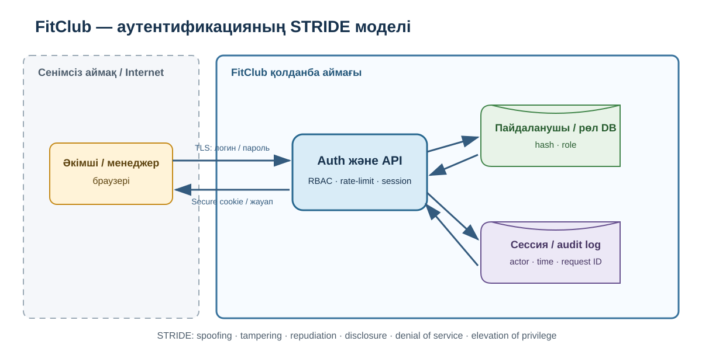

# FitClub аутентификациясының STRIDE моделі

## Қамту шекарасы

Модель әкімші/менеджер браузерінен FitClub Auth/API процесіне кіруді, пайдаланушы мен рөл дерекқорын, сессияны және аудит журналын қамтиды. Төлем жүйесі мен мобильді қосымша бұл итерацияға кірмейді.

## Деректер ағыны

1. Пайдаланушы TLS арқылы логин/пароль жібереді.
2. Auth/API пайдаланушыны DB-ден табады және пароль хэшін тексереді.
3. Қауіпсіз cookie-де қысқа мерзімді сессия идентификаторы беріледі.
4. Әр сұрауда сервер рөлді тексереді.
5. Кіру және әкімшілік өзгерістер audit log-қа жазылады.

## STRIDE талдауы

| Түрі | Қауіп сценарийі | Байланысты тәуекел | Бақылау |
|---|---|---|---|
| Spoofing | ұрланған пароль не brute-force арқылы басқа адам болып кіру | R10, R01 | salted hash, rate-limit, lockout, generic error |
| Tampering | cookie/session немесе role параметрін өзгерту | R01 | серверлік RBAC, signed/opaque session, input validation |
| Repudiation | әкімші клиент жазбасын өзгертіп, кейін жоққа шығару | R11 | actor/time/request ID бар audit log |
| Information disclosure | лог, response немесе экспорттан телефон/token шығуы | R02, R11 | минимизация, маскалау, least privilege, TLS |
| Denial of service | login endpoint-ке көп сұрау жіберу | R21 | rate-limit, timeout, health-check, alert |
| Elevation of privilege | менеджер әкімші функциясын шақыру | R01 | deny-by-default, permission matrix, negative API tests |

## Қауіпсіздік талаптары

- пароль тек adaptive hash түрінде сақталады;
- cookie: `HttpOnly`, `Secure`, `SameSite`;
- authorization тек UI-де емес, әр серверлік endpoint-та тексеріледі;
- сессия уақыты аяқталады және барлық құрылғыдан тоқтатуға болады;
- құпия дерек логқа жазылмайды;
- audit log-қа actor, action, target, time және request ID жазылады;
- 5 сәтсіз кіруден кейін жылдамдық шектеледі;
- backup қалпына келтіру RPO 24 сағ және RTO 4 сағ мақсатымен тексеріледі.

OWASP Threat Dragon файлы: `ThreatDragonModels/FitClub-Authentication/FitClub-Authentication.json`.
